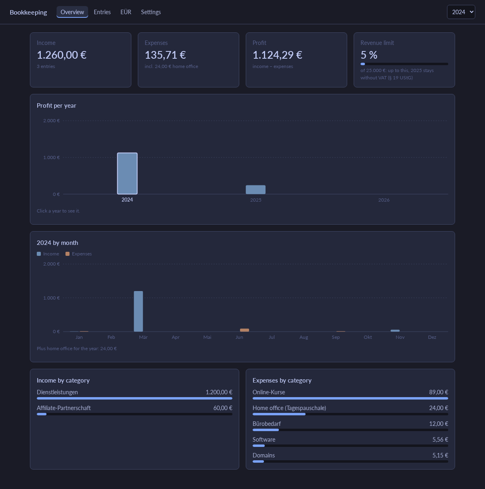
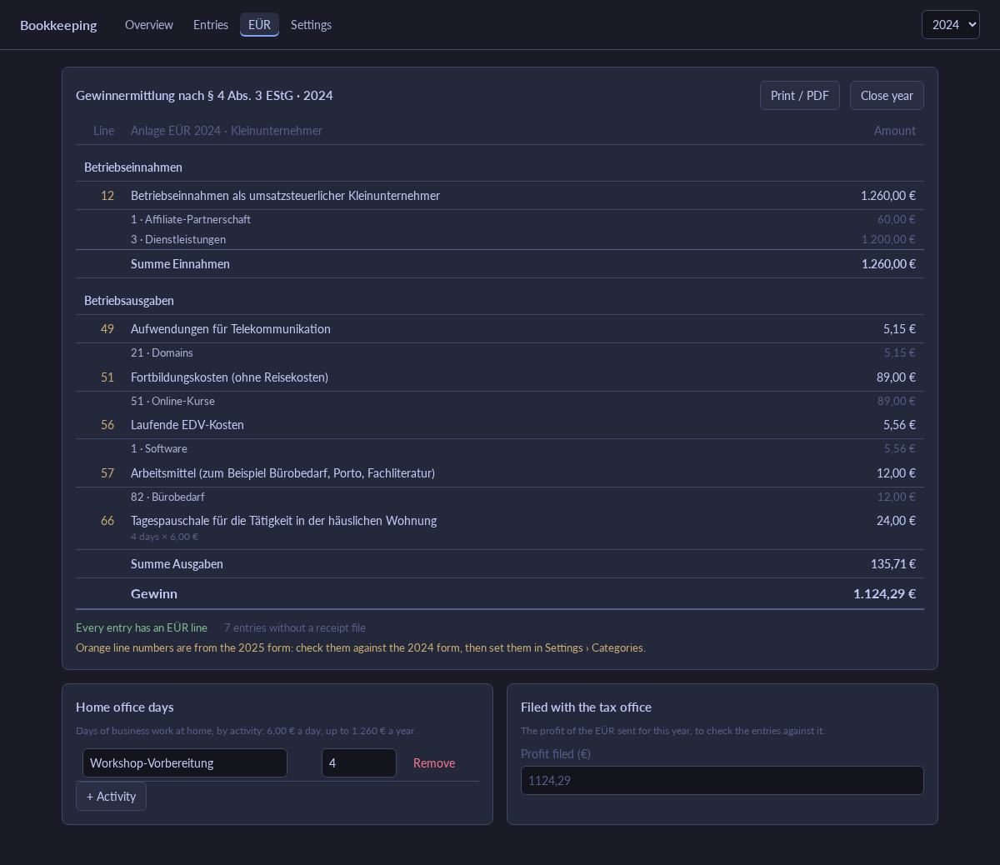

# Bookkeeping

Bookkeeping for a small business in Germany under the small-business VAT
exemption (Kleinunternehmer, § 19 UStG), as an app for
[Omarchy](https://omarchy.org/): income and expenses with their receipts,
categories linked to the lines of the official EÜR form, analytics across
all years, and each year's Einnahmenüberschussrechnung ready to type into
ELSTER. Years of old spreadsheets come in through a CSV import. No account
and no sync: everything stays on this computer.

It runs as an Omarchy web app: a small local server and a "Bookkeeping"
window in the app launcher. Colors follow the current Omarchy theme.



## Install

Needs Omarchy, Python 3.11 or newer, and Chromium (Omarchy's default
browser).

```bash
git clone https://github.com/simonmcschubert/omarchy-bookkeeping.git ~/.local/share/omarchy-bookkeeping
~/.local/share/omarchy-bookkeeping/setup
```

`setup` adds a user service (`omarchy-bookkeeping.service`) that runs the
server at login on `http://127.0.0.1:47221/`, and a "Bookkeeping" entry in
the app launcher (`Super+Space`). The server reads the code from the cloned
directory, so keep it where it is. To update: `git pull`, then `setup`
again. `setup --remove` takes the service and the launcher entry out; the
data stays.

## Views

- **Overview**: the year's income, expenses, profit and how close the
  revenue is to the Kleinunternehmer limit; profit per year since the first
  entry (click a year to open it); the year by month; income and expenses by
  category.
- **Entries**: every income and expense of a year, newest first, with its
  category, the EÜR line it counts on, and its receipt file (PDF, photo or
  e-invoice XML). Income gets the next running number by itself.
- **EÜR**: the Gewinnermittlung nach § 4 Abs. 3 EStG of a year, in the shape
  of the official form: each line with its number, its categories below it,
  the home-office days, totals and profit. **Print / PDF** prints it, followed
  by the year's income and expense lists, as the record to keep. Below: the
  home-office days by activity, and the profit filed with the tax office, to
  check the entries against it.
- **Settings**: categories and their EÜR lines, the line numbers of each
  year's form, the import, and the business details.



## The EÜR

Each category (an account number, Konto, and a name) is linked to one line of
Anlage EÜR. The line numbers change from year to year, so they are kept per
form year. A year without its own numbers uses those of the nearest form that
has them and shows them in orange, as a reminder to check them against that
year's form. The seeded numbers are those of the 2025 form; lines 12
(Kleinunternehmer income) and 66 (Tagespauschale) are from a tax guide, not
yet checked against the form.

Income counts when the money arrives, and expenses when they are paid
(Zuflussprinzip): the date of an entry is the day of payment.

**Close year**, after filing, keeps the year's entries from being changed by
mistake; **Reopen year** allows it again.

## Import the old spreadsheets

Each year's spreadsheet has an **Einnahmen** and an **Ausgaben** table. In
Numbers, **File › Export To › CSV** writes one file per table. In
**Settings › Import**, pick the files of as many years as wanted at once.

- Einnahmen: Datum, Betrag, Beschreibung, Rechnungsnr. (the own running
  number), Rechnungsnr. EXTERN (the payer's), Konto
- Ausgaben: Datum, Betrag, Text, Rechnungsnr. (the supplier's), Konto

The columns are found by their names, under any title row; empty rows and
the Summe row are skipped; amounts like `1.234,56 €` and dates like
`15.01.2025` are read. The table is told by the file name (Einnahmen or
Ausgaben) or the columns, and can be switched per file. The import shows
what it would add per year before anything is saved, leaves out entries that
are there already, and makes unknown account numbers into categories without
an EÜR line, to link in Settings › Categories. The home-office days of past
years go in by hand on the EÜR page.

## Data

- `~/.local/state/omarchy-bookkeeping/bookkeeping.json`: everything but the
  receipt files, in a directory only its owner can open
- `…/backups/`: a copy of that file from before the first change of each
  day, the last 60 days
- `…/receipts/`: receipt files, named by their content

## Not built yet

- Invoices as ZUGFeRD e-invoices (a normal PDF with the invoice data inside),
  marked paid to become income
- Reading received e-invoices (ZUGFeRD, XRechnung) into expenses
- Assets and their depreciation (AfA)
- A nightly copy of the data and receipts to another computer
- An update button, as in Finance

## Development

```bash
node --test                               # app logic and import
python3 -m unittest discover -s test -v   # server
python3 server.py --port 47321 --data /tmp/books.json   # try it
```

The app is plain JavaScript modules and a Python standard-library server; no
build step. `CONTEXT.md` lists the words the code uses.
