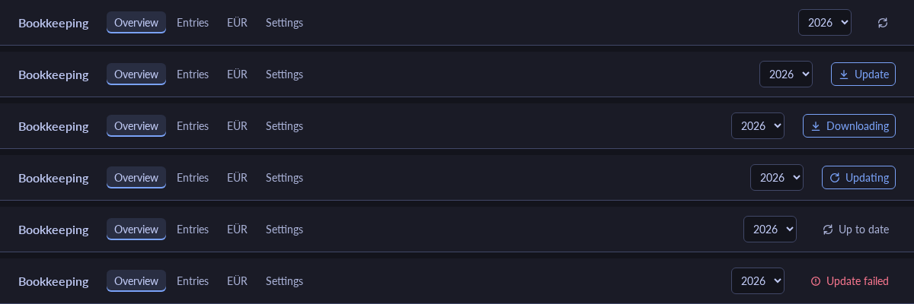
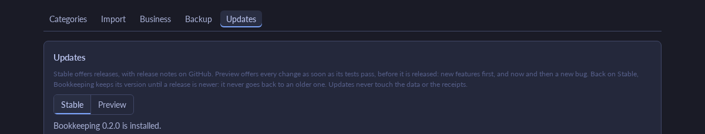
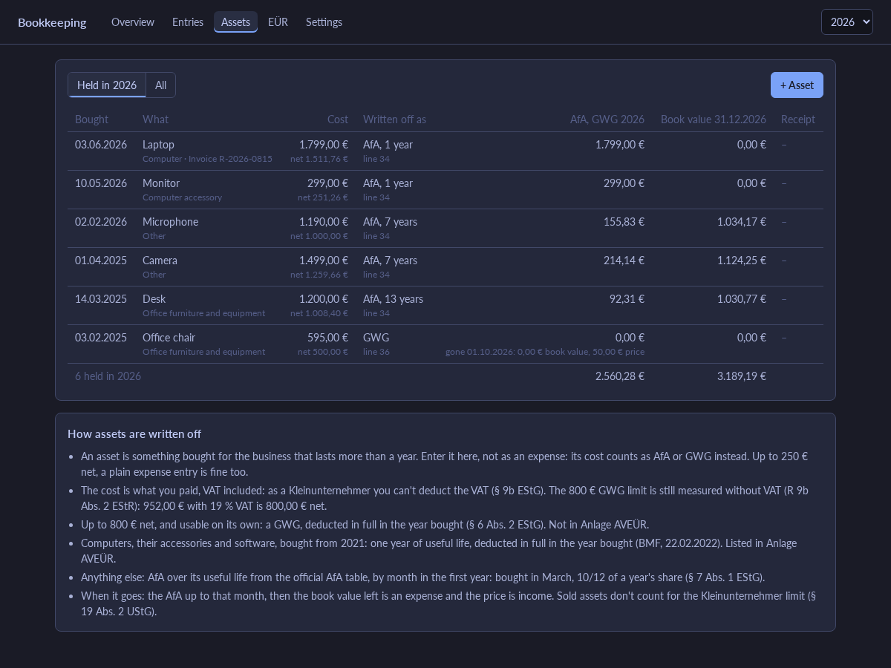
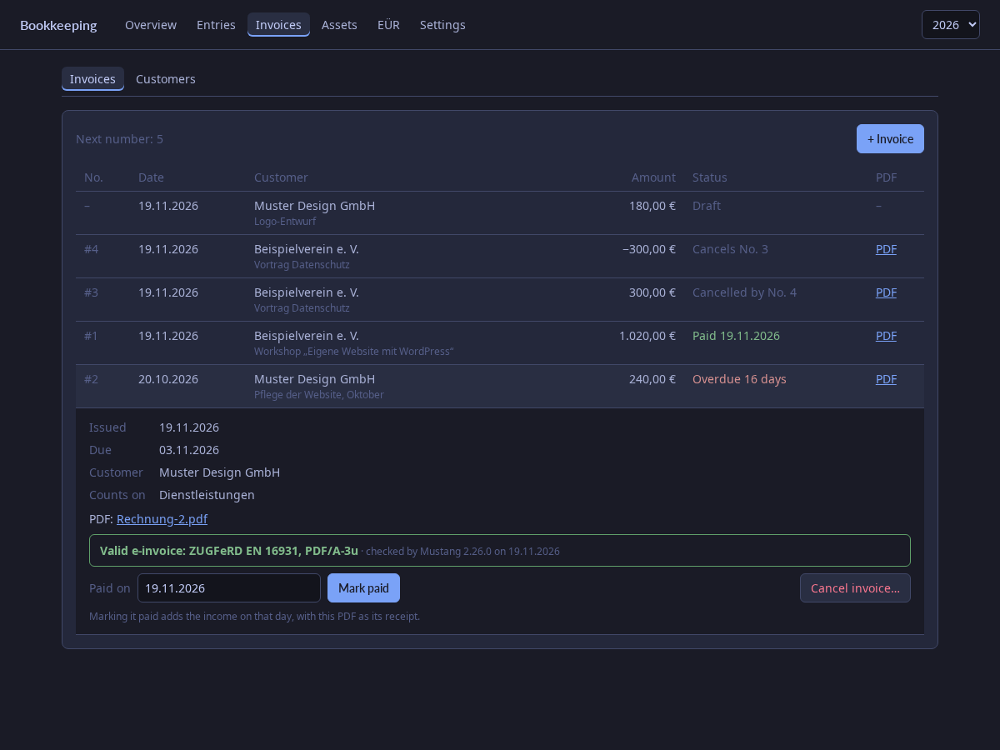
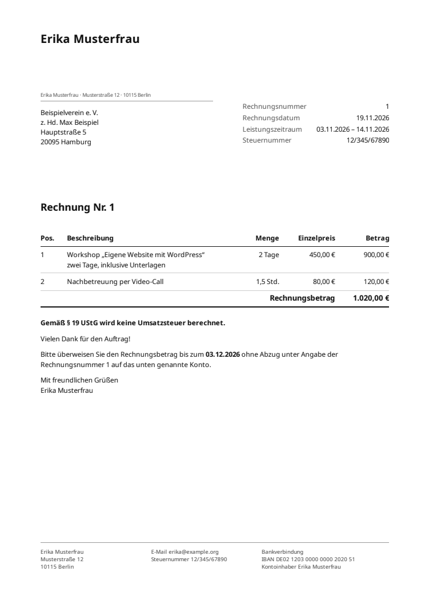
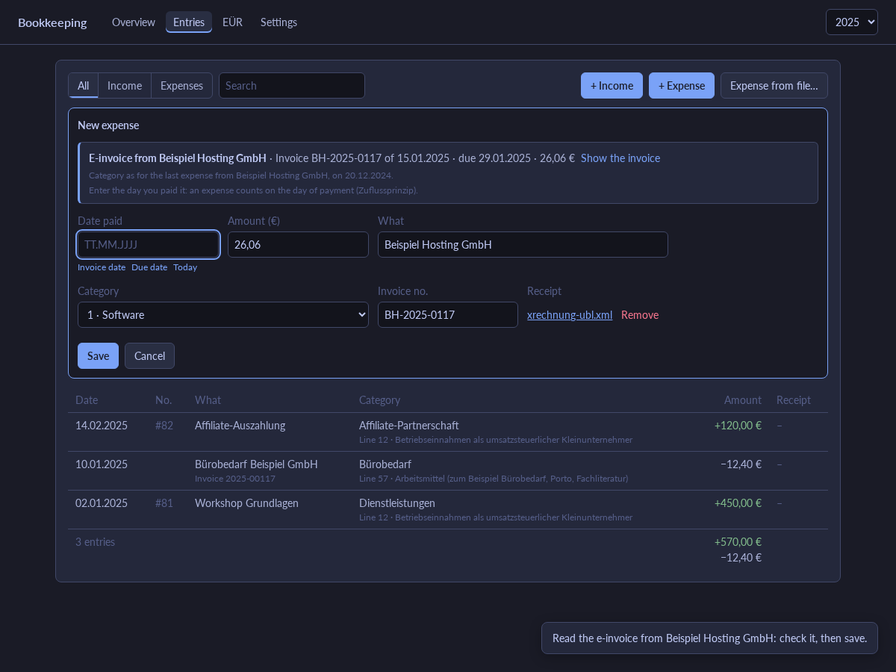
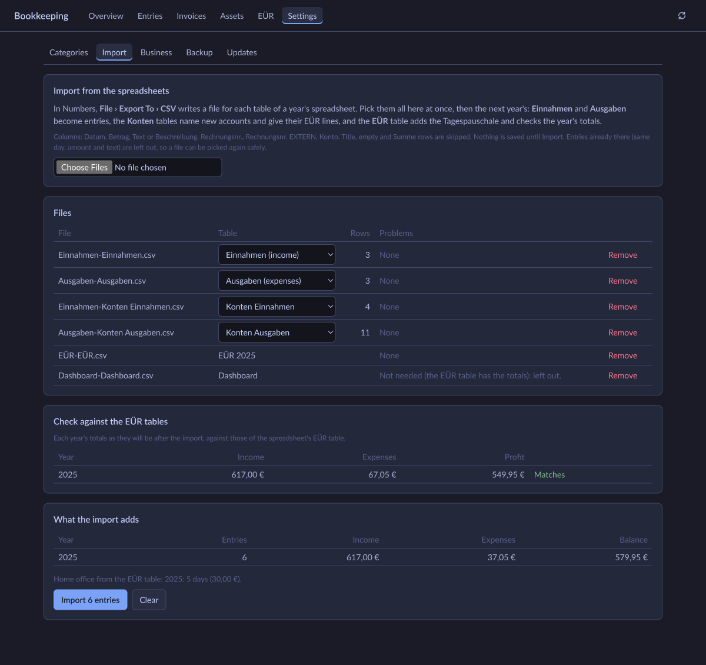

# Bookkeeping

Bookkeeping for a small business in Germany under the small-business VAT
exemption (Kleinunternehmer, § 19 UStG), as an app for
[Omarchy](https://omarchy.org/): income and expenses with their receipts,
invoices as ZUGFeRD e-invoices, categories linked to the lines of the
official EÜR form, analytics across all years, and each year's
Einnahmenüberschussrechnung ready to type into ELSTER. Received e-invoices
(XRechnung, ZUGFeRD) become expenses, and years of old spreadsheets come in
through a CSV import. No account and no sync:
everything stays on this computer, plus, if set up, a nightly copy on
another computer of your own.

It runs as an Omarchy web app: a small local server and a "Bookkeeping"
window in the app launcher. Colors follow the current Omarchy theme.


## Install

Needs Omarchy, Python 3.11 or newer, and Chromium (Omarchy's default
browser). Invoice PDFs also need Java and pikepdf, which `setup` installs
(see [Invoices](#invoices)).

```bash
git clone https://github.com/simonmcschubert/omarchy-bookkeeping.git ~/.local/share/omarchy-bookkeeping
~/.local/share/omarchy-bookkeeping/setup
```

`setup` adds a user service (`omarchy-bookkeeping.service`) that runs the
server at login on `http://127.0.0.1:47221/`, and a "Bookkeeping" entry in
the app launcher (`Super+Space`). For invoices it installs Java
(`jre-openjdk-headless`) and pikepdf (`python-pikepdf`) with pacman, asking
for sudo only when one is missing, and downloads the Mustang validator
(one Java file, about 60 MB, checked against its SHA-256) into `tools/`.
The server reads the code from the cloned directory, so keep it where it
is. It updates itself: see [Update](#update). `setup --remove` takes the
service, the launcher entry and `tools/` out; the data stays. `setup
--backup` sets up the nightly copy to another computer (see
[Backup](#backup)).

## Update

Bookkeeping looks for a new release 15 seconds after its server starts and
every four hours. The update button, a circle of arrows at the right end of
the top bar, checks now when clicked; hover it to see the installed version.
When there is a release, the button turns into a down arrow with **Update**.
One click downloads and installs it: Bookkeeping waits for any change still
being saved or an invoice PDF still being made, restarts its server with
the release and reloads the window. A window with a form open (an entry, an
asset, an invoice or a customer) reloads only once it is saved or
cancelled, and says **Updated** meanwhile; so does a window open while
another one, or a terminal, installs an update. A
release downloaded otherwise (`update download` in a terminal, or a window
closed while it downloaded) shows **Restart to update** instead, which
installs it the same way. When the new server does not answer, Bookkeeping
goes back to the version it had. A notification confirms the update or says
why it failed. When it fails before the restart (local changes in the
checkout, for example), the button says **Update failed** and why, when
hovered. Like `git pull`, this does not show the changes first; the release
notes on GitHub list them.



Updates never touch the data: they change only the code in the cloned
directory, not the data file, its daily copies or the receipts. They never
go back to an older version either, because an older version could lose what
a newer one saved. A data file saved by a newer version stays closed in an
older one, which says so instead of showing it, so nothing is saved over it.

Settings › Updates chooses which updates the button offers. **Stable**, the
default, offers releases. **Preview** offers every change on `main` as soon
as CI has passed for it, days or weeks before it is released: new features
first, and now and then a new bug. A preview is named by its commit, such as
`preview 1a2b3c4`, and the installed version then reads `0.2.0-3-g1a2b3c4`:
three commits past 0.2.0. Previews have no release notes; the commits on
GitHub list the changes. Back on Stable, Bookkeeping keeps the version it
has until a release is newer. Before the first release, Stable offers
nothing.



Looking for updates asks the repository Bookkeeping was cloned from (GitHub)
for its tags, and on Preview for its `preview` branch. Nothing about the data
is sent.

The same from a terminal:

```bash
~/.local/share/omarchy-bookkeeping/update check
~/.local/share/omarchy-bookkeeping/update install 0.2.0
~/.local/share/omarchy-bookkeeping/update channel preview   # or stable
```

`git -C ~/.local/share/omarchy-bookkeeping pull && ~/.local/share/omarchy-bookkeeping/setup`
works too. It takes the newest commit on `main`, released or not. Run
`setup` again after an update when the release notes say so, for changes to
the service or the launcher entry.

## Views

- **Overview**: the year's income, expenses (with the year's AfA), profit
  and how close the revenue is to the Kleinunternehmer limit; the open
  invoices (sent, not paid) and which are overdue; profit per year since the
  first entry (click a year to open it); the year by month; income by
  category and by customer; expenses by category.
- **Entries**: every income and expense of a year, newest first, with its
  category, the EÜR line it counts on, and its receipt file (PDF, photo or
  e-invoice XML). Income gets the next running number by itself, and can
  name its customer. A receipt or e-invoice dropped on the page becomes a new
  expense. An expense that is really an asset becomes one with **Make it an
  asset**.
- **Invoices**: the year's invoices with their status (draft, sent,
  overdue, paid, cancelled) and PDF, and the customers.
- **Assets**: what was bought to last more than a year, such as a laptop or
  a desk, with its cost, useful life, receipt and, later, the day it went
  and its price; for each, how it is written off and its book value at the
  end of the year.
- **EÜR**: the Gewinnermittlung nach § 4 Abs. 3 EStG of a year, in the shape
  of the official form: each line with its number, its categories below it,
  the home-office days, totals and profit, then what to type into Anlage
  AVEÜR. **Print / PDF** prints it, followed by the year's income and expense
  lists and the asset list, as the record to keep. Below: the home-office days
  by activity, and the profit filed with the tax office, to check the entries
  against it.
- **Settings**: categories and their EÜR lines, the line numbers of each
  year's form, the import, the business details, the VAT status of each
  year, the backup (when the last copy to another computer was made), and
  which updates to offer.




## The EÜR

Each category (an account number, Konto, and a name) is linked to one line of
Anlage EÜR. The line numbers change from year to year, so they are kept per
form year. A year without its own numbers uses those of the nearest form that
has them and shows them in orange, as a reminder to check them against that
year's form. The seeded numbers are those of the 2025 form; lines 12
(Kleinunternehmer income) and 66 (Tagespauschale) are from a tax guide, not
yet checked against the form.

Income counts when the money arrives, and expenses when they are paid
(Zuflussprinzip): the date of an entry is the day of payment.

## Assets and AfA

An asset is entered in **Assets**, not as an expense, so its price counts
once: as AfA or GWG, spread as the rules say. Each rule, with its source
(EStG, EStR, BMF letters, the 2025 and 2026 forms), is written out at the top
of `app/assets.mjs`. In short:

- The cost is what was paid, VAT included: a Kleinunternehmer can't deduct
  the VAT. Whether something is a GWG is still decided on the price without
  VAT (R 9b Abs. 2 EStR), so each asset has the VAT rate of its invoice.
- Up to 800 € net, if it can be used on its own: a GWG (geringwertiges
  Wirtschaftsgut), deducted in full in the year bought, on its own line.
- Computers, their accessories and software bought from 2021: one year of
  useful life, deducted in full in the year bought (BMF, 22.02.2022), on the
  AfA line. Monitors and printers are never GWG; this covers them.
- Anything else: AfA in equal amounts over its useful life from the official
  AfA table, by month in the first year.
- When it goes: AfA up to that month, then the book value left is an
  expense and the price is income. Sales don't count for the revenue limit.

The asset lines (Veräußerung von Anlagevermögen, AfA, GWG, Restbuchwerte)
come with their numbers from the 2025 and 2026 forms. The EÜR page lists what
goes into **Anlage AVEÜR** (Anlageverzeichnis), which belongs to the EÜR
whenever there is AfA; GWG don't go in it. The pool for 250 to 1.000 €
(Sammelposten) is left out: it would only help with things of 800 to 1.000 €
that aren't computers, and would slow down everything of 250 to 800 € bought
the same year.

**Close year**, after filing, keeps the year's entries from being changed by
mistake; **Reopen year** allows it again.

## Invoices



An invoice starts as a draft: a customer, the invoice date, the date or
period of the service, lines (what, quantity, unit, price), the days to
pay, and the category its income counts on. A preview shows the page as
it will print. **Issue invoice** gives it the next running number and
makes the PDF; from then on it can't change.

The PDF is a [ZUGFeRD](https://www.ferd-net.de/) e-invoice (version 2.5.2,
the same as Factur-X 1.09.2): a normal-looking invoice with the invoice
data inside as XML (UN/CEFACT CII, profile EN 16931), so the customer's
software can read it. It is made in three steps:

1. Chromium prints the invoice page to a PDF.
2. pikepdf, a Python library for editing PDFs, makes that PDF/A-3 (the
   archive form of PDF that may carry such a file) and attaches the XML.
3. The [Mustang](https://www.mustangproject.org/) validator, a Java
   program, checks the PDF/A and the XML against the EN 16931 rules, as the
   customer's software would.

Only an invoice that passes is kept, like a receipt, in `receipts/`; the
Invoices view shows the check's result and opens the PDF again.



The page holds what § 14 Abs. 4 UStG asks for: both names and addresses,
the Steuernummer, the dates of the invoice and the service, the number,
the lines, the amount, and the note **Gemäß § 19 UStG wird keine
Umsatzsteuer berechnet.** In the XML, a Kleinunternehmer's lines are
tax-exempt (VAT category E) with the reason "Kein Ausweis von
Umsatzsteuer, da Kleinunternehmer gemäß § 19 UStG", as KoSIT and FeRD
write it.

- **Mark paid** asks for the day the money came and adds the income on that
  day (Zuflussprinzip), with the invoice's number, customer and PDF.
  **Mark unpaid** takes it back.
- **Cancel invoice** makes a cancellation invoice (Stornorechnung) with a
  number of its own, the same lines counted negative and a reference to
  the invoice it cancels; it is checked and kept the same way. A paid
  invoice can't be cancelled yet (refunds are not built).
- The VAT status is kept per year in **Settings › Business**:
  Kleinunternehmer unless a year is set to charge VAT. The year of the
  service decides (for a period, the year it ends). Invoices with VAT are not built yet: a year that charges
  VAT can't issue one.

## Received e-invoices

Since 2025 every business in Germany must be able to receive e-invoices,
Kleinunternehmer too (BMF letter of 15.10.2024, Rn. 40); an email address
is enough for that. Bookkeeping reads them into expenses. On the Entries
page, drop a file on the page or pick it with **Expense from file…**:

- **An e-invoice** opens a new expense, filled in from it: the supplier, the
  invoice number and the amount to pay. That is XRechnung or another EN 16931
  invoice as XML (UBL or CII syntax), or a ZUGFeRD / Factur-X PDF with that
  XML inside. Choose the category (the one of the last expense from the same
  supplier is chosen already) and set the day it was paid: the date stays
  empty, as an expense counts on the day of payment (Zuflussprinzip). The
  invoice's own dates are a click away under the field. A credit note becomes
  a refund, a negative expense; an invoice in another currency leaves the
  amount to type in euros.
- **Any other PDF or photo** becomes the receipt of a new expense.
- **A file that is no e-invoice, or a broken one**, says so and stays a
  plain receipt.

With an entry open, a dropped file becomes its receipt. **E-invoice** in the
receipt column shows the invoice in readable form: supplier, buyer, items,
VAT, totals and how to pay. The file itself is kept as the receipt, unchanged,
as an e-invoice must be (BMF letter of 15.10.2025, Rn. 60).

The app reads e-invoices; it does not validate them against the standard,
and only warns when the totals don't add up. ZUGFeRD files of the profiles
MINIMUM and BASIC WL are read with a note that they are no e-invoice under
§ 14 UStG (BMF letter of 15.10.2024, Rn. 25). ZUGFeRD 1.0 is not read.



## Import the old spreadsheets



In Numbers, **File › Export To › CSV** writes one file per table of a
year's spreadsheet, such as `Einnahmen-Einnahmen.csv` or `EÜR-EÜR.csv`. In
**Settings › Import**, pick all of them at once, then the next year's. The
files picked together are taken as one year: that of the EÜR table, else
that of the entries, unless a file's name has another (`2023 Konten
Ausgaben.csv`). Each file is told by its columns, not its name:

- **Einnahmen**: Datum, Betrag, Beschreibung, Rechnungsnr. (the own running
  number), Rechnungsnr. EXTERN (the payer's), Konto. Becomes income.
- **Ausgaben**: Datum, Betrag, Text, Rechnungsnr. (the supplier's), Konto.
  Becomes expenses.
- **Konten Einnahmen**, **Konten Ausgaben**: Konto and Beschreibung, and for
  expenses Zeile Form and Kategorie, the form line the accounts below it are
  on. An account the books don't have yet gets its name and its EÜR line
  from here: the line of the same label (without its "zum Beispiel …"), or
  else the one with that number on the year's form. A line the books don't
  have becomes a new one, with its number. The table's line numbers also go
  into that year's form where it has none yet (Settings › Categories).
- **EÜR**: its Tagespauschale becomes the year's home-office days (the
  amount ÷ the day rate; left out when the EÜR page has days already, or the
  amount is no whole number of days). Its Summe Einnahmen, Summe Ausgaben
  and Saldo are checked against the year as the import leaves it: **Check
  against the EÜR tables** says *Matches* or shows the difference, before
  anything is saved.
- **Dashboard**: not needed, as the EÜR table has the totals; left out, as
  is any other file.

The columns are found by their names, under any title row; empty rows, rows
like `;0;;;;` and the Summe row are skipped; amounts like `1.234,56 €` and
dates like `15.01.2025` are read. Income or expenses are told by the file
name (Einnahmen or Ausgaben) or the columns, and can be switched per file.
The import shows what it would add per year before anything is saved, and
leaves out entries that are there already and closed years. An account no
Konten table names becomes a category without an EÜR line, to link in
Settings › Categories. A year without its EÜR table gets its home-office
days by hand on the EÜR page.

## Data

- `~/.local/state/omarchy-bookkeeping/bookkeeping.json`: everything but the
  receipt files, in a directory only its owner can open
- `…/backups/`: a copy of that file from before the first change of each
  day, the last 60 days
- `…/receipts/`: receipt files and invoice PDFs, named by their content and
  never changed. XML files are served as plain text; the page shows
  e-invoices as the server reads them (`einvoice_reader.py`)
- `…/backup-status`: the result of the last backup;
  `~/.config/omarchy-bookkeeping/backup.conf`: where it goes

Updates leave all of it as it is ([Update](#update)).

## Backup

Once a day, Bookkeeping can copy the data, its daily copies and the receipts
to another computer over SSH, such as a home server. Run once, with the
server's user and name, and a folder there of its own:

```bash
~/.local/share/omarchy-bookkeeping/setup --backup user@server:backups/omarchy-bookkeeping
```

Both computers need rsync (on Omarchy: `sudo pacman -S rsync`), and the
server needs this computer's SSH key in `~/.ssh/authorized_keys`. Connect
once by hand before (`ssh user@server true`), to confirm the server's host
key. Run setup in a terminal where that `ssh` works: if the key is in an SSH
agent (such as `ssh-tpm-agent`), setup saves where the agent is, for the
timer. It then makes the first copy and says whether it worked.

- **What**: everything in `~/.local/state/omarchy-bookkeeping` but the
  window's browser profile.
- **When**: a user timer (`omarchy-bookkeeping-backup.timer`) runs every
  hour, also right after a wake-up or start, and copies once a day. When the
  server can't be reached, it says so in one line of the journal and tries
  again an hour later.
- **Kept**: everything, for good. Nothing on the server is ever deleted. A
  file that changed here replaces its copy there, and the old copy moves to
  `replaced/<date and time>/`; receipts never change, so each stays as it
  was copied. The books must be kept for ten years and receipts for eight,
  counted from the end of the year (§ 147 AO). A mistake that got copied may
  be found only years later, at the next EÜR or in a tax audit; with every
  version kept, it can still be traced and undone. And it is small: ten
  years of 200 entries make a data file of about 800 KB; with changes on 100
  days a year, all copies of ten years stay under 1 GB.
- **Status**: Settings › Backup shows the last copy and why a try failed;
  the Overview warns when changes have waited more than three days.
- **Copy now**: `~/.local/share/omarchy-bookkeeping/backup`. **Stop**:
  `setup --no-backup`; the copies stay.
- **Check the timer**: `systemctl --user list-timers omarchy-bookkeeping-backup.timer`
  and `journalctl --user -u omarchy-bookkeeping-backup`.

To go back to an earlier version, copy it from the server over
`bookkeeping.json` here and reload the window.


## Not built yet

- Invoices with VAT (Regelbesteuerung), and the VAT in the EÜR
- Refunds of paid invoices
- For assets: the declining-balance AfA for things bought from July 2025 to
  2027, special AfA (§ 7g), cars, things brought in from private property
  (Einlage), private use of an asset, and the Sammelposten

## Development

```bash
node --test                               # app logic, import, invoices, backup status, update button, update script
python3 -m unittest discover -s test -v   # server, invoice PDFs, backup script, setup --backup, updates.py
python3 server.py --port 47321 --data /tmp/books.json   # try it
python3 test/einvoice_samples.py          # rewrites the sample e-invoices
```

`test/fixtures/numbers-2025/` is a made-up year's spreadsheet as Numbers
exports it, to pick in Settings › Import. `test/fixtures/einvoices/` holds made-up e-invoices (XRechnung in UBL and
CII, a credit note, a ZUGFeRD PDF) to drop on the Entries page.

Without Chromium, Java, pikepdf or `tools/mustang-cli.jar`, the tests that
make real invoice PDFs are skipped. `BOOKKEEPING_CHROMIUM`,
`BOOKKEEPING_JAVA` and `BOOKKEEPING_MUSTANG` point the server at other
copies, and `BOOKKEEPING_CHROMIUM_NO_SANDBOX=1` runs Chromium without its
sandbox where the system blocks it (Ubuntu, CI).

The app is plain JavaScript modules and a Python standard-library server
(reading e-invoices too, PDFs included; making invoice PDFs needs the tools
above); no build step. `CONTEXT.md` lists the words the code uses.

```text
server.py          # page, /api/data, receipts, daily backups, /theme.css, /api/backup, /api/einvoice, /api/invoices, /api/update
invoice_pdf.py     # makes invoice PDFs (Chromium, pikepdf) and has Mustang check them
einvoice_reader.py # reads received e-invoices (XML or ZUGFeRD PDF)
updates.py         # the Updater behind /api/update: runs the update script
update             # finds, downloads and installs releases or previews
backup             # the nightly copy to another computer
app/
├── app.mjs        # the views; saves every change
├── books.mjs      # data, EÜR and numbers (no DOM)
├── assets.mjs     # assets and their AfA (no DOM)
├── assets-view.mjs # the Assets view and the asset parts of the EÜR
├── einvoice.mjs   # received e-invoices: the expense and the readable view (no DOM)
├── invoices.mjs   # customers and invoices: issue, paid, cancel, open (no DOM)
├── invoice-xml.mjs # an invoice's ZUGFeRD XML (no DOM)
├── invoice-html.mjs # an invoice's printed page, with invoice.css (no DOM)
├── invoices-view.mjs # the Invoices view and its Overview cards
├── import.mjs     # the spreadsheet import (no DOM)
├── backup.mjs     # the backup's status (no DOM)
└── update.mjs     # the update button, and the channel in Settings › Updates
setup              # user service, launcher entry, backup timer and invoice tools; --remove undoes
```

The update button, `updates.py`, `update` and the Release and Preview
workflows are Finance's, with Bookkeeping's names, port and unit; a change to
one belongs in the other too. The tests of `update` run it against real git
repositories, with stand-ins for `systemctl` and `curl`. A server started as
above offers updates too, but `update install` refuses a checkout that
`omarchy-bookkeeping.service` does not run, so installing one fails there.

## Releases

Actions › Release › Run workflow, with patch, minor, or major; the first
release starts from 0.0.0, so minor gives 0.1.0. The workflow tags the `main`
commit that passed CI as `vX.Y.Z` and creates the GitHub Release with notes
from the merged pull requests. The tags hold the version (`update version`);
no file does. Installed copies offer the release within four hours. "Release
candidate" publishes `vX.Y.Z-rc.N`, which they do not offer, and "Dry run"
shows the version and notes without publishing.

Previews need no step: once CI passes for a commit pushed to `main`, the
Preview workflow fast-forwards the `preview` branch to it, and copies on
Preview offer it within four hours.
